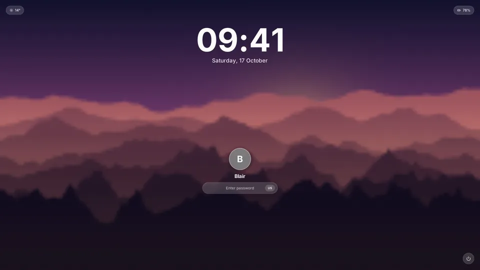
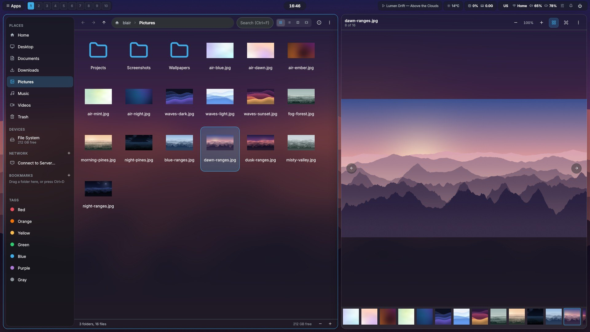

<div align="center">

# b1air

**A calm, keyboard-first Wayland desktop for Linux.**
One look everywhere — the shell, its apps, other apps, the lock and login screens.



[](LICENSE)
[](src/swayfx)
[](src/shell)
[](src/daemon)

Arch · Debian 13 / Ubuntu 25.04 · Fedora 40 · openSUSE Tumbleweed

</div>

## In use




## What you get

- **The desktop** — SwayFX with blur, rounded corners and animations of
  its own (overview, window snapping, zoom), a top bar, Spotlight, the
  Launchpad, Control Center, notifications and a calendar.
- **Its apps** — Files, Git, Terminal, Text, View, Camera, Monitor and
  Settings, all in the same glass ("Air") style.
- **One theme for everything** — Breeze or Adwaita, light or dark, or made
  from your wallpaper; GTK, Qt and the terminal follow it.
- **Small native tools** instead of the usual helpers: lock screen,
  wallpaper, clipboard, night light, screenshots.
- **Windows programs** through Proton, games in the gaming edition,
  fingerprint login, phones and iPods in Files.

More in [docs/FEATURES.md](docs/FEATURES.md).

## Install

```bash
git clone --recurse-submodules https://github.com/bla1r1/DotsFiles.git ~/DotsFiles
cd ~/DotsFiles && ./install.sh            # or ./install-ui.sh for a menu
```

Editions: `--edition minimal`, `default` (adds Windows programs, Flatpak,
containers, VPN) or `gaming`. Details, flags and other distributions:
[docs/INSTALL.md](docs/INSTALL.md).

## A few keys

| | |
| :--- | :--- |
| `Super + Space` | Spotlight |
| `Super + T` / `E` | Terminal / Files |
| `Super + C` | Control Center |
| `Super + V` | Clipboard |
| `Print` | Screenshot |
| `Ctrl + Alt + L` | Lock |

All of them: [docs/KEYBINDINGS.md](docs/KEYBINDINGS.md).

## More

[Features](docs/FEATURES.md) · [Install](docs/INSTALL.md) ·
[Keys](docs/KEYBINDINGS.md) · [Command line](docs/CLI.md) ·
[Repository layout](docs/STRUCTURE.md) · [Roadmap](docs/ROADMAP.md)

Everything here is b1air's own and **GPL-2.0-only** — the wallpapers too
([how they are drawn](.wallpapers/CREDITS.md)).
