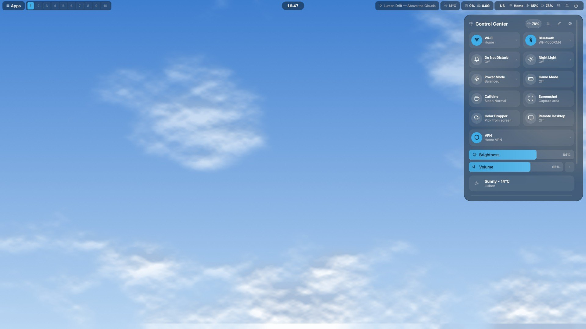
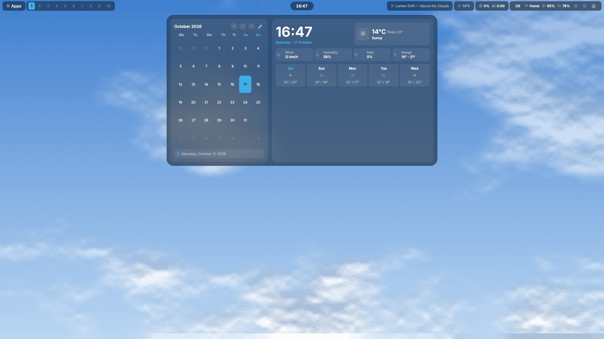
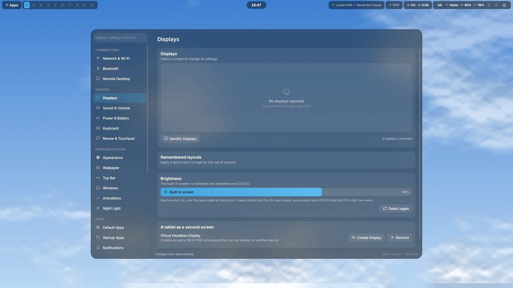
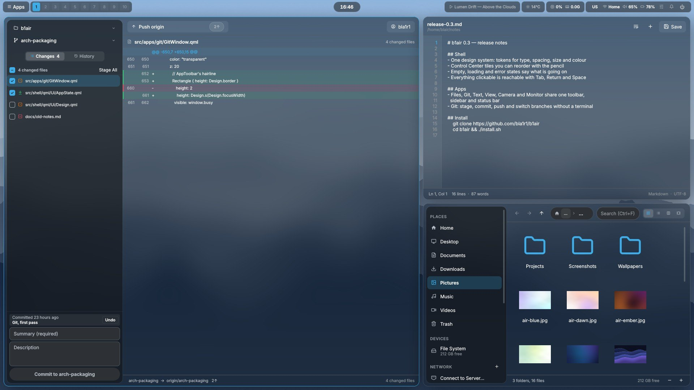

# What b1air does

b1air is a unified desktop setup for Linux designed around keyboard efficiency, low latency, and one theme across every application — dark or light.

Key components:
* **Compositor**: SwayFX with hardware-accelerated rounded corners, soft shadows, and selective blur. The theme picked in Settings colours everything from one palette: the shell and the native apps (`Ui/Design.qml`), window borders, GTK and Qt/Kvantum applications, the terminal, the lock screen and the login screen.
* **Core Daemon (`b1air-daemon`)**: A single compiled C++20 binary that manages window autotiling, focus tracking (SQLite3), audio and microphone controls (PipeWire via `wpctl`), PAM user profiles, and power management without shell script overhead.
* **Desktop Shell**: Lightweight Qt6/QML overlays providing an application launcher, clipboard history, control center, emoji picker, and a visual Alt+Tab window switcher.
* **First-run setup**: at the first login, Settings walks through language and keyboard, Wi-Fi, theme, wallpaper, the account and its fingerprint. After an update it shows only the steps that are new, and a step only when the machine has the hardware for it (no reader, no fingerprint step).
* **Own small tools** in place of the usual helpers, each with its tests: `b1air-lock` (the lock screen, instead of swaylock), idle handling inside the daemon (instead of swayidle), `b1air-clip` (instead of wl-clipboard), `b1air-gamma` (night light with a schedule, instead of wlsunset), `b1air-bg` (wallpaper, instead of swaybg), `b1air-shot` (the Print overlay: region, recording, QR — instead of a QML one started per press).
* **Lock screen**: `b1air-lock` by default — up in milliseconds, before the machine sleeps: each screen's wallpaper blurred, clock, account picture and name, one password field for every screen, keyboard layout, battery, weather, and a reboot / sleep / shut down menu. It is the only lock screen — no QML; one that dies while locked is replaced by a new one, the session staying locked.
* **Fingerprint** (fprintd): the installer finds the reader by its USB id and installs the driver libfprint lacks — python-validity for the Validity/Synaptics readers of many ThinkPads (`06cb:009a`), the Goodix builds for others (Arch; `lib/fingerprint.sh`); updates add it when a reader appears. Enrol and test fingers in Settings → Lock & Login; a touch opens either lock screen. Optionally at the login screen too (an empty password and Enter, then the reader) — only SDDM's PAM file is changed; sudo, polkit and the console keep asking for the password.
* **Phones and iPods in Files**, as Finder shows them: an iPod's music and playlists with their covers — drag songs or albums on, FLAC and Ogg are converted on the way — through [podsync](https://github.com/bla1r1/podsync) (`third_party/podsync`); an iPhone's photos (imported into Pictures), the files its apps share, and a full backup (libimobiledevice); an Android phone's storage and photos over MTP, with its battery when USB debugging is on.
* **Remote Access**: Built-in headless WayVNC support and unattended screencasting configuration for AnyDesk, RustDesk, and OBS with persistent uinput permissions.

## Themes and wallpapers

Four built-in themes, after the two big desktops: **Breeze Dark** (the
default) and **Breeze Light** from KDE, **Adwaita Dark** and **Adwaita Light**
from GNOME — chosen for text, dim text and borders that are clearly apart
rather than a few shades of one tint. A theme can also be made from the
wallpaper, created, edited and shared as a file (Settings → Appearance).

The wallpapers are b1air's own, drawn by `tools/make-wallpapers.py` — skies,
mountains, forests, water and soft abstract gradients — and GPL-2.0-only like
the rest (`.wallpapers/CREDITS.md`). They are sorted into folders —
Abstract, Forest, Mountains, Sky, Water — which Settings → Wallpaper
offers as categories; a folder of your own in `~/.wallpapers` becomes one too.
A first login starts on the daytime clouds (`Sky/clouds-day.jpg`).

## Spotlight Launcher (`Super + Space`)
Fuzzy application search, clipboard history, and inline math calculations in a single centered overlay.

## Settings & Control Center (`Super + Shift + S` / `Super + C`)
Graphical desktop configuration:
* Wallpaper selection by category, per screen or per workspace, and a theme built from the wallpaper (Appearance → From the wallpaper).
* Audio sink selector and per-stream volume controls.
* Focus time and screen usage analytics stored in SQLite.
* Toggles for Night Light, Game Mode (disables blur and pins performance governor), and Remote Desktop.

## Login screen (SDDM)
Takes the desktop's live palette (written by `b1air-daemon` to `/var/cache/wallpaper`), in the look of the lock screen: the clock, the account picture and name, the password, the session, the keyboard layout and the power buttons, and fingerprint login when it is turned on in Settings → Lock & Login.

## Pictures

| | |
| :---: | :---: |
|  |  |
| Control Center | Calendar and weather |
|  |  |
| Settings | Git, Text and Files |

*Rendered from the QML in this repository with sample data, offscreen, with
the compositor's blur added.*
